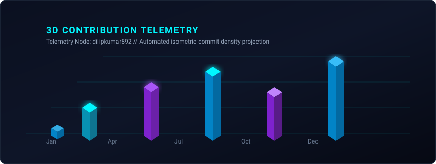

<div align="center">

  <!-- ==================== HERO HEADER BANNER ==================== -->
  

  <!-- ==================== ANIMATED TYPING SVG ==================== -->
  <a href="https://github.com/dilipkumar892">
    
  </a>

  <!-- ==================== QUICK STATUS BADGES ==================== -->
  <p align="center">
    <a href="https://github.com/dilipkumar892">
      
    </a>
    <a href="https://linkedin.com/in/dileep-kumar-bardhan">
      
    </a>
    <a href="mailto:dilipkumar8923@outlook.com">
      
    </a>
    
  </p>

</div>

---

### 🌐 System Overview & Diagnostics

```yaml
User: Dileep Kumar
Role: Desktop Support Engineer
Specialization: Windows Ecosystem, Enterprise IT Infrastructure & Hardware Support
Location: India
Availability: Full-Time / IT Support Roles / Technical Operations
Core Philosophy: "Troubleshoot accurately, automate systematically, resolve proactively."
```

<br/>

<div align="center">
  
</div>

<br/>

## 👨‍💻 About Me

Hello! I am **Dileep Kumar**, a dedicated and detail-oriented **Desktop Support Engineer**. I specialize in keeping systems running at peak performance, resolving complex OS and hardware incidents, managing network routing, and administering users across corporate domains.

- 🖥️ **Operating System Expertise:** In-depth diagnosis of Windows 10/11, registry fixes, crash dump analysis, and performance tuning.
- 🏢 **Identity & Access Management:** User provisioning, permission delegation, and policy rollout via **Active Directory & Group Policy (GPO)**.
- 🔌 **Hardware & Networking:** Assembly, component lifecycle diagnosis, BIOS/UEFI firmware management, TCP/IP, DNS, and DHCP configuration.
- 📡 **Remote Assistance:** High-availability remote technical support, seamless incident triage, and SLA compliance.
- ⚡ **Automation Mindset:** Writing PowerShell and batch utilities to eliminate repetitive manual administration tasks.

---

## 🛠️ Technical Competency & Toolchain

<div align="center">

### 💻 Operating Systems & Enterprise Administration
<p>
  
  
  
  
  
  
</p>

### 🌐 Networking & Protocols
<p>
  
  
  
  
  
  
</p>

### 🔧 Hardware & Diagnostics
<p>
  
  
  
  
  
</p>

### 📡 Remote Assistance & Service Management
<p>
  
  
  
  
  
</p>

### ⚡ Scripting, Automation & Tools
<p>
  
  
  
  
  
  
</p>

</div>

---

## 📊 GitHub Analytics & Telemetry

<div align="center">
  <table border="0" cellspacing="0" cellpadding="0">
    <tr valign="top">
      <td>
        <a href="https://github.com/dilipkumar892">
          
        </a>
      </td>
      <td>
        <a href="https://github.com/dilipkumar892">
          
        </a>
      </td>
    </tr>
  </table>
  <br/>
  <a href="https://github.com/dilipkumar892">
    
  </a>
</div>

---

## 🧊 Interactive 3D Contribution Hologram

<div align="center">
  <p><em>Rendered with automated GitHub Action pipelines every 24 hours</em></p>
  <picture>
    <source media="(prefers-color-scheme: dark)" srcset="./profile-3d-contrib/profile-night-rainbow.svg">
    <source media="(prefers-color-scheme: light)" srcset="./profile-3d-contrib/profile-night-rainbow.svg">
    
  </picture>
</div>

---

## 🐍 GitHub Activity Grid Snake

<div align="center">
  <p><em>Autonomous contribution eater tracking git commits across all repositories</em></p>
  <picture>
    <source media="(prefers-color-scheme: dark)" srcset="https://raw.githubusercontent.com/dilipkumar892/dilipkumar892/output/github-contribution-grid-snake-dark.svg">
    <source media="(prefers-color-scheme: light)" srcset="https://raw.githubusercontent.com/dilipkumar892/dilipkumar892/output/github-contribution-grid-snake.svg">
    
  </picture>
</div>

---

## 🚀 Featured IT & Engineering Projects

<table width="100%">
  <tr>
    <td width="50%" valign="top">
      <h3 align="center">🛠️ Windows Troubleshooting Toolkit</h3>
      <p align="center">
        
        
      </p>
      <p>A unified suite of automated PowerShell scripts designed for desktop support engineers to resolve Windows update failures, corrupt system files (SFC/DISM), network stack resets, and event-log triage.</p>
      <p align="center">
        <a href="https://github.com/dilipkumar892/windows-troubleshooting-toolkit">
          
        </a>
      </p>
    </td>
    <td width="50%" valign="top">
      <h3 align="center">🔌 Localhost & Port Diagnostic Toolkit</h3>
      <p align="center">
        
        
      </p>
      <p>Lightweight network diagnostic utility for probing open socket connections, analyzing port conflicts, ping latency benchmarking, and DNS resolution troubleshooting across local subnets.</p>
      <p align="center">
        <a href="https://github.com/dilipkumar892/localhost-port-diagnostic-toolkit">
          
        </a>
      </p>
    </td>
  </tr>
  <tr>
    <td width="50%" valign="top">
      <h3 align="center">⚡ IT Support Automation Tools</h3>
      <p align="center">
        
        
      </p>
      <p>Streamlined scripts for enterprise IT operations: silent software deployment, automated user workstation onboarding, printer mapping, and cache clearance across domain-joined machines.</p>
      <p align="center">
        <a href="https://github.com/dilipkumar892/it-support-automation-tools">
          
        </a>
      </p>
    </td>
    <td width="50%" valign="top">
      <h3 align="center">🤖 AI Personal Assistant</h3>
      <p align="center">
        
        
      </p>
      <p>Intelligent desktop assistant utility created to assist engineers with voice/text command execution, scheduled system maintenance routines, quick knowledge search, and repetitive task dispatching.</p>
      <p align="center">
        <a href="https://github.com/dilipkumar892/ai-personal-assistant">
          
        </a>
      </p>
    </td>
  </tr>
  <tr>
    <td colspan="2" valign="top">
      <h3 align="center">🏢 RentPulse PRO</h3>
      <p align="center">
        
        
      </p>
      <p align="center">Property and tenant operations tracking system designed for tracking leasing agreements, maintenance tickets, payment statuses, and asset audits in one intuitive interface.</p>
      <p align="center">
        <a href="https://github.com/dilipkumar892/rentpulse-pro">
          
        </a>
      </p>
    </td>
  </tr>
</table>

---

## 📬 Initialize Connection

Feel free to reach out to discuss IT support, systems troubleshooting, network configurations, or potential job opportunities!

<div align="center">

  <a href="https://www.linkedin.com/in/dileep-kumar-bardhan" target="_blank">
    
  </a>
  &nbsp;
  <a href="mailto:dilipkumar8923@outlook.com" target="_blank">
    
  </a>
  &nbsp;
  <a href="https://github.com/dilipkumar892" target="_blank">
    
  </a>

</div>

<br/>

<!-- ==================== ANIMATED FOOTER ==================== -->
<div align="center">

  

  <p align="center">
    ⚡ <em>Crafted with precision & automated by GitHub Actions</em> ⚡<br/>
    <sub>© Dileep Kumar (dilipkumar892). All systems operational.</sub>
  </p>

</div>

